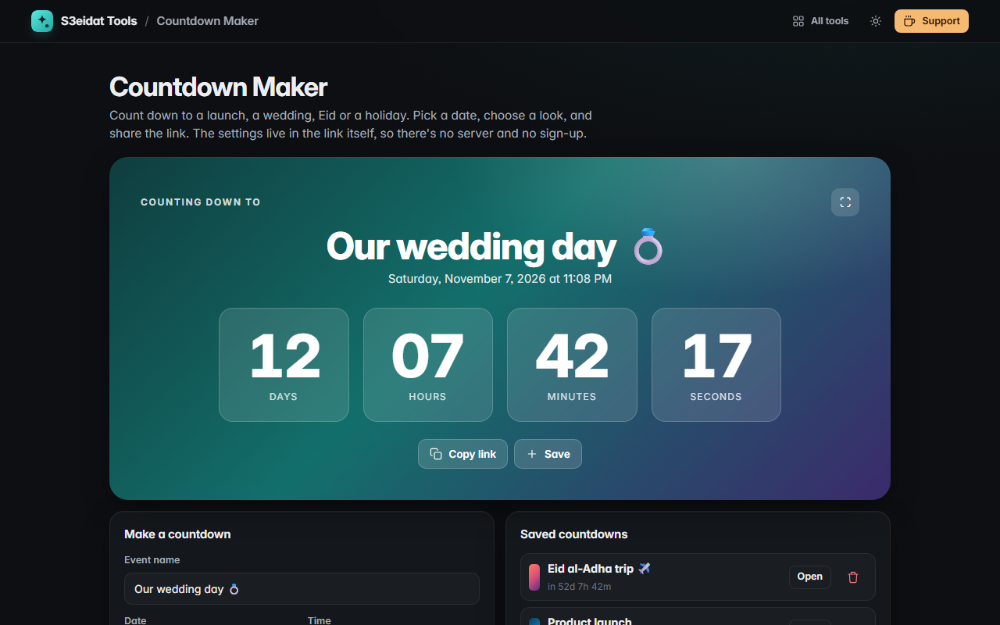

# Countdown Maker

> Beautiful countdowns to any date that you can share as a link. Free, private, and it runs entirely in your browser.

### ▶ [Open Countdown Maker](https://s3eidat.github.io/countdown-maker/)



## Features

- Event name, date and time, and six **themes**
- Big **live countdown**: days, hours, minutes and seconds (it keeps counting the time since, once the moment has passed)
- **Share as a link**: the settings are stored in the link itself (<code>#n=…&t=…&th=…</code>), so there is no server; viewers see the same moment in their own time zone
- **Fullscreen** mode for screens and projectors; **confetti** when it reaches zero
- **Saved countdowns** list on your device
- Safe links: the name, time and theme in a link are validated, length-limited and shown as plain text only

## Privacy

Saved countdowns are kept only in your browser (localStorage). A shared link carries just the name, time and theme you typed, inside the part of the URL after <code>#</code>, which browsers do not send to any server.
The page ships with a strict Content-Security-Policy (`connect-src 'self'`), so the browser
itself blocks any attempt to send data anywhere.

## Run it yourself

It's plain HTML, CSS and JavaScript with no build step:

```bash
git clone https://github.com/s3eidat/countdown-maker
cd countdown-maker
python -m http.server 8000
```

Then open http://localhost:8000.

## Support

If this saved you time, **[buy me a coffee ☕](https://s3eidat.github.io/coffee/)**. It keeps every tool free.

---

Part of **[S3eidat Tools](https://s3eidat.github.io/)**: 100+ free, private tools that run in your browser. MIT licensed.
